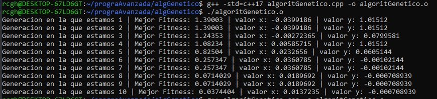

# Tarea 5 Algortimo genético utilizando STL

Para esto minimizaremos la función sigueinte, llamada Rastrigin

$$f(x,y) = 20 + (x^{2} - 10 cos(2\pi x)) + (y^{2} - 10 cos(2\pi y))$$

En un dominio acotado [-5.12,5.12] \in R

Secuencia del algoritmo 

1. Definir estructura del individuo.(Definiremos el contenedor de vector)

2. Generamos una población. Utilizaremos una distribucion uniforme entre [0,1] para poder crear los cromosamos iniciales de forma aleatoria.

3. Cruza de genes
Para esto de dos padres generaremos dos hijo.
Definimos una probabilidad de cruza "probCruza", la definiremos con una probabilidad de 0.9. Elegimos un punto de corte sobre los cromosomas, esto con una funcion que nos genera valores entre 0 y 63, por ejemplo si elegimos el indice 37, todos los valores del 37 al 63 , es decir la cola del cromosoma padre2 pasará a los cromosomas del hijo1, de la misma forma los indices del 37  al 63 del padre1 irán a la cola del cromosoma hijo2.
Como resultado tendremos de dos cromosomas padres dos cromosomas hijos cruzados.

4. Mutacíon de genes
La mutacion sirve para evitar que la función se quede atrapada en soluciones poco eficientes.

    Para esto introduciremos cambios aleatorios, para esto definiremos una probabilidad muy baja de mutacion es decir 1% (0.01), si el valor aleatorio generado es decir "disReal" es menor o igual a esta probabilidad de mutación, se invertirá el bit, es decir si es 0 pasa a 1, si es 1 pasa a 0.

5. Evaluaremos la función f(x,y), para toda la población. Para esto decodificaremos los bit en numeros reales.

6. Ordenamos la poblacion para encontrar los valores que minimicen la función.

* Utilizando un tamaño de población de: 1000

* Una probabilidad de cruza: 0.9

* Una probabilidad de mutación de: 0.01

* Y un numero de generaciones de: 10

Nota se ejecutó de la sigueinte manera al ingresar esta estructura auto [hijo1,hijo2], que permite desempaquetar valores como el que se mencionó

auto [hijo1, hijo2] = cruzar(padre1, padre2, probCruza, gen);

Por lo que se necesita la bandera 

$ g++ -std=c++17 algoritGenetico.cpp -o algoritGenetico.o

Bibliografía

- https://www.geeksforgeeks.org/dsa/genetic-algorithms/

## Hugo Miranda Cano