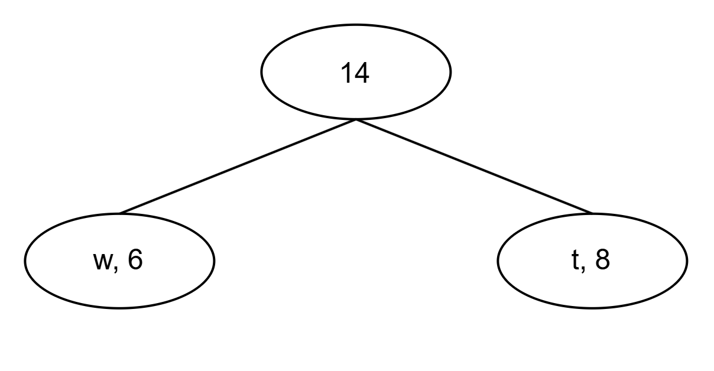
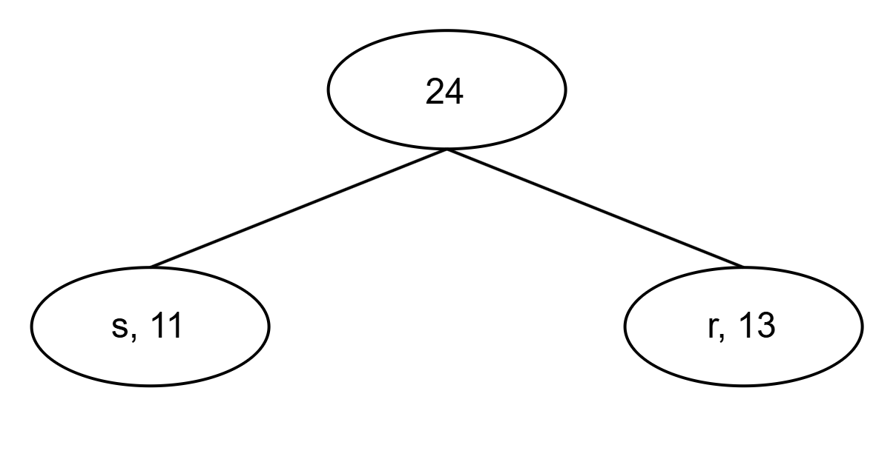
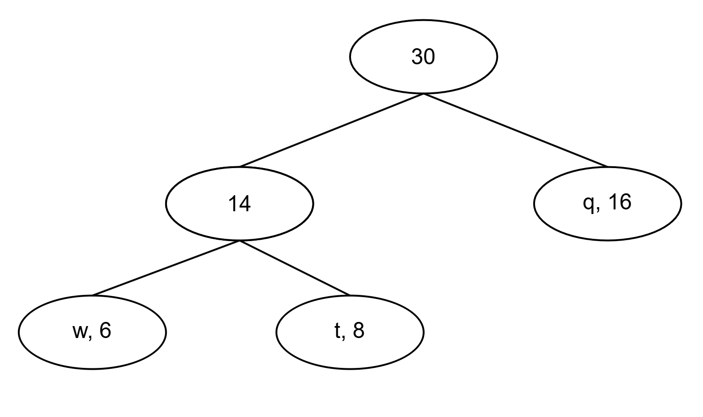
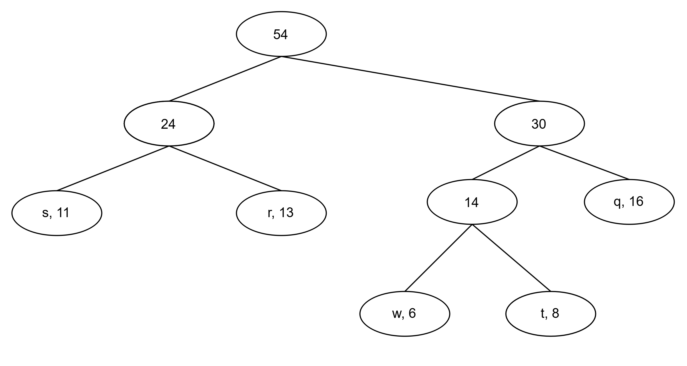
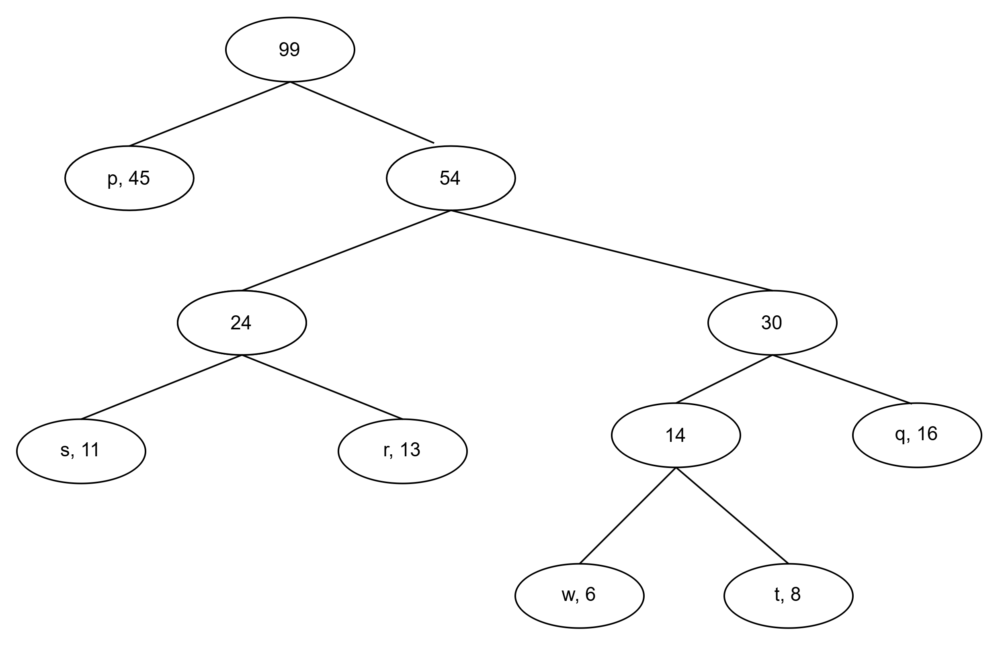
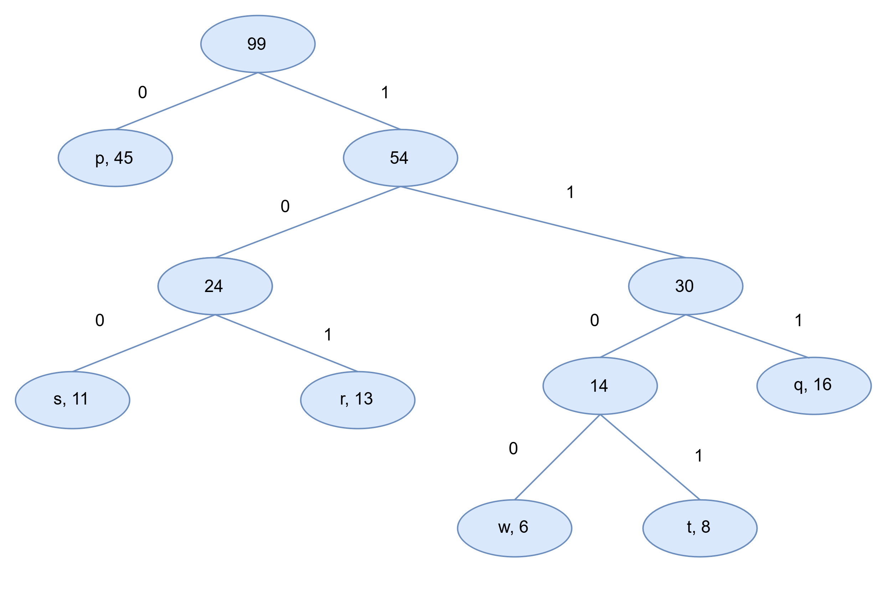

# Tarea 6 Codificación huffman

La codificación hoffman es un algoritmo utilizado para la compresion de datos.

El método de codificación de huffman consta de dos partes:

1. Construye un árbol de Huffman a partir de los caracteres introducidos.
2. Recorre el arbol de Huffman y asigna códigos a los personajes. 

Pasos para construir un árbol de Huffman
Este algoritmo construye un árbol de abajo hacia arriba utilizando una cola de prioridad (o montón) .
La entrada es una matriz de caracteres únicos junto con su frecuencia de aparición y la salida es un árbol de Huffman. 

1. Creamos nodos hojas para cada carácter único, ademas se construye un montículo mínimo con todos los 
nodos hoja. 

2. Extraiga dos nodos con la frecuencia mínima del montón mínimo. 

3. Crea un nuevo nodo interno con una frecuencia igual a la suma de la FRECUENCIA de los dos nodos. 
Asigna el primer nodo extraído como su hijo izquierdo y el otro nodo extraído como su hijo derecho. 
Agrega este nodo al montón mínimo.

4. Repetimos los pasos 2 y 3 hasta que el montón contenga un solo nodo. 
El nodo restante es la raíz y el árbol está completo.

Ejemplo ilustrativo

Frecuencia de carcateres:
p = 45  
q = 16
r = 13
s = 11
t = 8
w = 6

Paso 1. Se crean los nodos hojas para los caracteres mostrados arriba

Paso 2. Extraemos los dos nodos con la frecuencia más pequena del monton. Añadimos un nuevo nodo
con frecuecia igual a 8 + 6 = 14

Notar que ahora el monton tiene 5 nodos, 4 nodos hojas y un nodo con 3 elementos.

Aplicamos la propiedad de monton minimo quedando las nuevas frecuencias como:

Frecuencia de carcateres:
p = 45  
q = 16
Nuevo nodo = 14
r = 13
s = 11

Paso 3 Extraemos nuevamente nodos de frecuencia minima. Esto es r + s = 13 + 11 = 24 

Frecuencia de carcateres:
p = 45  
Nuevo nodo 2 = 24
q = 16
Nuevo nodo 1 = 14

Ahora tendremos 4 nodos, 2 hojas y dos arboles con mas de un nodo.

Paso 4 Extraemos nuevamente dos nodos minimos. q + Nuevo nodo 1 = 16 + 14 = 30. Y lo añadimos.

Frecuencia de carcateres:
p = 45  
Nuevo nodo 3 = 30
Nuevo nodo 2 = 24

Ahora tendremos 3 nodos, 1 hojas y dos arboles con mas de un nodo.

Paso 5 Extraemos dos nodos minimos. Nuevo nodo 3 + Nuevo nodo 2 = 30 + 24 = 54. Y lo añadimos.

Frecuencia de carcateres:

Nuevo nodo 4 = 54
p = 45  

Paso 6. Extraemos los dos ultimos nodos minimos del monticulo. Y los sumamos. 54 + 45 = 99

Ahora la frecuencia del ultimo nodo es de 99.

Para imprimir los códigos del arbol de Huffman.

Recorreremos del nodo raiz. Al movernos hacia el nodo izquierdo escribiremos 0, y si nos movemos 
hacia el nodo hijo derecho escribimos 1. Quedandonos de la sigueinte manera

Código

p = 0  
q = 111
r = 101
s = 100
t = 1101
w = 1100

Se utilizó c++ para su implementación.

Al elegir 1

Bibliografía

https://www.geeksforgeeks.org/dsa/huffman-coding-greedy-algo-3/