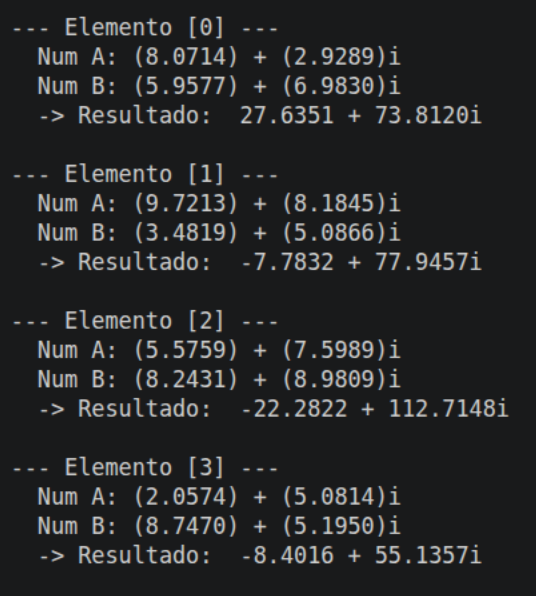
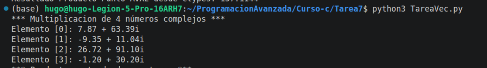
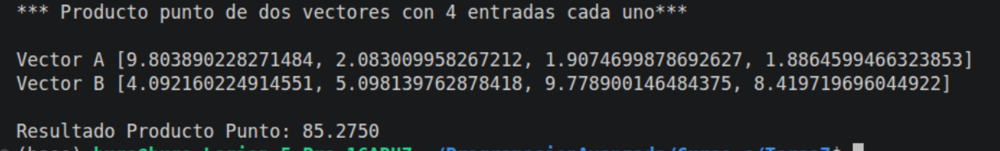
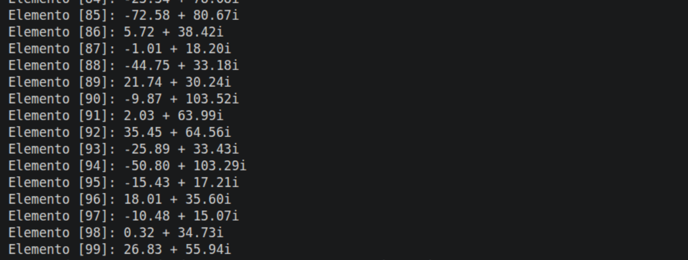
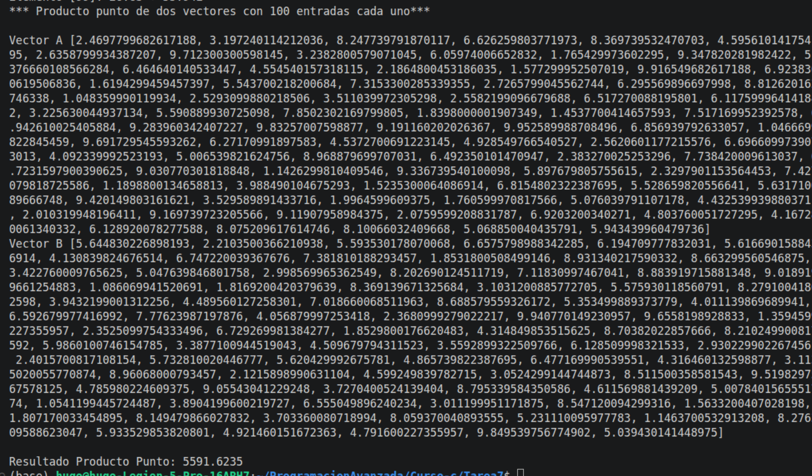

# Tarea 7 Creación de biblioteca y enlazarla en un script de python con ctypes.

Se realizó la multiplicacion de números complejos y producto punto de dos vectores con intrinsics. Se puede modificar el número de operaciones a realizar, se mostrará para 4 elementos.

La multiplicación de números complejos

Sea a,b $\in C$ dos números complejos de la forma $a = x + yi$, para realizar la multiplicación de
estos números se hace lo siguiente


$$
\mathbf{a} = x + yi
$$


$$
\mathbf{b} = k + zi
$$


$$
\mathbf{i*i} = -1
$$


$$
\mathbf{c} = x*k + x*zi + k*yi - y*z
$$

De esta forma tenemos 

$$
\mathbf{c} = x*k - y*z + i(x*z + k*y)
$$


Para este ejercicio se generarón números aleatorios entre 1.0 y 10.0, y se formaron estos números complejos, para efectuar 4 multiplicaciones se generarón 8 numeros complejos al azar.

Por ejemplo




### Flujo Visual de los Registros (256 bits)

Suponiendo dos pares de números complejos: \((a + bi) \cdot (c + di)\) y \((e + fi) \cdot (g + hi)\):

```text
1. Carga desde RAM (_mm256_loadu_pd):
   v_x = [   f   |   e   |   b   |   a   ]
   v_y = [   h   |   g   |   d   |   c   ]

2. Reordenamiento y Duplicación (_mm256_permute_pd):
   v_y_real (0x00) = [   g   |   g   |   c   |   c   ]  (Duplica partes reales de Y)
   v_y_imag (0x0F) = [   h   |   h   |   d   |   d   ]  (Duplica partes imaginarias de Y)
   v_x_perm (0x05) = [   e   |   f   |   a   |   b   ]  (Invierte real/imag de X)

3. Multiplicación Vertical Simultánea (_mm256_mul_pd):
   prod_real = v_x * v_y_real      --> [  f*g  |  e*g  |  b*c  |  a*c  ]
   prod_imag = v_x_perm * v_y_imag --> [  e*h  |  f*h  |  a*d  |  b*d  ]

4. Resta/Suma Alternada (_mm256_addsub_pd):
   Resta en carriles pares (0, 2) y suma en carriles impares (1, 3):
   res = [ fg + eh | eg - fh | bc + ad | ac - bd ]
          └─ Imag 2 ─┘└─ Real 2 ─┘└─ Imag 1 ─┘└─ Real 1 ─┘

5. Escritura en RAM (_mm256_storeu_pd):
   Guarda ambos resultados complejos de golpe en el arreglo destino z[i] y z[i+1].
```

---


## Intrisics utilizados

* `_mm256_loadu_pd`: Carga 256 bits en 4 paquetes de 64 bits. NO necesita ser alineado en memoria.
 
* `_mm256_permute_pd`: Reordena elementos de puntos flotante de doble precision (64 bits) dentro de segmentos de 128 bits

* `_mm256_mul_pd`: Multiplica elementos de 64 bits empaquetados en a y b. Se almacena resultado.

* `_mm256_addsub_pd`: Suma y resta alternadamente elementos de punto flotante de doble precision (64 bits) en paquetes a y b. Almacena resultado.

* `_mm256_storeu_pd`: Almacena 256 bits en 4 paquetes de elementos de puntos flotante de presicion simple (64 bits). NO nocesita estar alineado en memoria.


# Producto punto 

Sea a,b $\in R^{n}$, donde a, b son vectores de longitud n. El producto punto se define de la siguiente forma

Sea 

$$
\mathbf{a} = [a_1, a_2, a_3, \dots, a_n]
$$


$$
\mathbf{b} = [b_1, b_2, b_3, \dots, b_n]
$$

$$
\mathbf{a} \cdot \mathbf{b} = [a_1, a_2, a_3, \dots, a_n] \cdot [b_1, b_2, b_3, \dots, b_n] = \sum_{i=1}^{n} a_i b_i
$$

De la misma forma se generan vectores a y b aleatorios


### 2. Flujo Visual de Acumulación y Reducción Horizontal

Suponiendo el procesamiento de los primeros 8 elementos (`i = 0` hasta `7`):

```text
1. Carga desde RAM (_mm256_loadu_ps):
   num1 = [ a7 | a6 | a5 | a4 | a3 | a2 | a1 | a0 ]
   num2 = [ b7 | b6 | b5 | b4 | b3 | b2 | b1 | b0 ]

2. Multiplicación y Suma Fusionada (_mm256_fmadd_ps):
   Multiplica cada columna y la acumula en num3:
   num3 = [ s7 | s6 | s5 | s4 | s3 | s2 | s1 | s0 ]  (donde s_k = a_k * b_k)

3. Primera Suma Horizontal (_mm256_hadd_ps):
   Suma pares adyacentes dentro de cada mitad de 128 bits:
   num3 = [ s7+s6 | s5+s4 | s7+s6 | s5+s4 | s3+s2 | s1+s0 | s3+s2 | s1+s0 ]

4. División en Registros de 128 bits (_mm256_extractf128_ps):
   top = [ s7+s6 | s5+s4 | s7+s6 | s5+s4 ]  (Parte alta)
   bot = [ s3+s2 | s1+s0 | s3+s2 | s1+s0 ]  (Parte baja)

5. Reducción Final (_mm_add_ps + _mm_hadd_ps):
   - Suma vertical (top + bot): combina los resultados altos y bajos.
   - Suma horizontal final: simplificación.
   top = [ Total | Total | Total | Total ]

6. Extracción a Escalar (_mm_store_ss):
   Guarda el primer elemento (posición 0) en la variable float 'total'.
```


## Intriscs utilizados

* `_mm256_loadu_ps`: cargar 256 bit en 8 bloques de 32 bits.

* `_mm256_fmadd_ps`: Multiplicar los elementos del punto flotante de 32 bits enpaquetados en a y b, y el elemento intermedio 
c es sumado.

* `_mm256_hadd_ps`: Hacer la suma horizontal de paquetes de 32 bits adyacentes y los almacena en el destino.
 
* `_mm256_extractf128_ps`: Extraer 128 bits en 4 paquetes de punto flotante de 32 bits, y almacenados en una variable de 128 bits

* `_mm256_add_ps`: Sumar elementos de punto flotante de precision simple (32 bits) empaquetados en a y b, y almacena los resultados.

* `_mm_store_ss`: Almacena el elemento de punto flotante inferior de 32 bits en memoria. mem_addr no necesita estar alineado en ningún límite en particular.

* `_mm256_setzero_ps`: INicializa registros de 256 bits con ceros.

## Requerimientos 

Compilado en g++ 15.2.0

## Compilación 

```bash
$ g++ -O3 -shared -fPIC -msse -march=native TareaVec.cpp -o TareaVec.so
```

Banderas

* O3: Nivel máximo de optimización.

* -march=native habilita todas las banderas.

* -msse: Habilita el conjunto de intrucciones SSE

* -shared: Genera un objeto compartido. (.so)

* fPIC: Genera instrucciones que permiten cargar la bilbioteca en cualquier direccion de memoria.


# Enlazando con python

Ctypes es una biblioteca de funciones foraneas para python. Proporciona tipos de datos compatibles con C y permite llamar funciones en archivos DLL(windows) o bibliotecas compartidas como Linux (.so).

Se importa ctypes

biblioteca = ctypes.CDLL('./TareaVec.so')

Una instancia de .CDLL representa una biblioteca compartida cargada, que exporta funciones en este caso de TareaVec.so


## Ejecución

```bash
$ python3 ./TareaVec.py
```
Resultado de multiplicar 8 números complejos, como resultado nos da 4 numeros complejos. 




Producto punto 

Se realiza el producto punto 2 dos vectores con 4 elmentos cada uno




Ejercicio con 100 elementos

Multiplicación de complejos





Producto punto




# Bibliografía

https://github.com/oneapi-src/oneAPI-samples/blob/master/DirectProgramming/C%2B%2B/CompilerInfrastructure/Intrinsics/src/intrin_dot_sample.cpp

https://www.intel.com/content/www/us/en/docs/intrinsics-guide/index.html

https://gcc.gnu.org/onlinedocs/gcc/x86-Options.html


https://gcc.gnu.org/onlinedocs/gcc/Link-Options.html